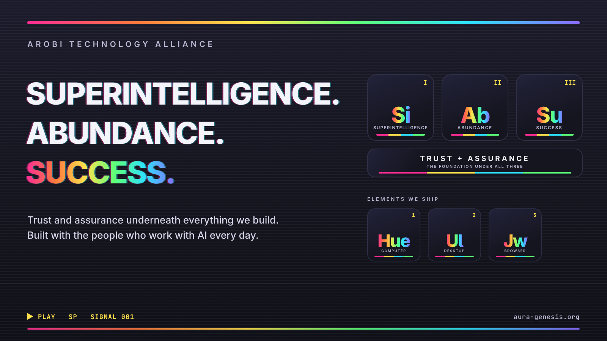
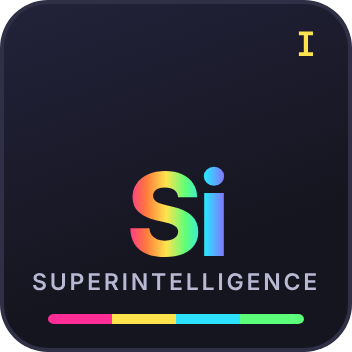
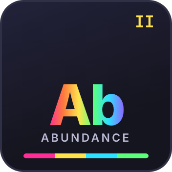
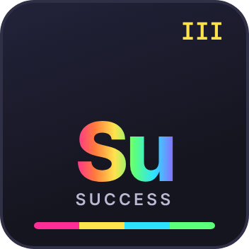
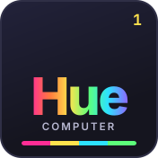
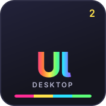
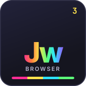

  

# Arobi Technology Alliance

**Superintelligence. Abundance. Success.** Trust and assurance underneath everything we build.

Arobi Technology Alliance, Inc. builds technology that lets people hand real work to capable AI and stay in charge of it.
Our product is **Ullumii**, one workspace that does the work and proves it, and behind it **Immaculate**, which checks
who is acting, what they are allowed to do and the rules they set before an important action runs.

This repository is where we tell the story in public as it unfolds: what we believe, what we ship, who we build with,
and what changed. It is a high-level window. Our engineering, research and strategy stay private.

## Three pillars

<table>
  <tr>
    <td align="center" width="33%"></td>
    <td align="center" width="33%"></td>
    <td align="center" width="33%"></td>
  </tr>
  <tr>
    <td valign="top"><b>Superintelligence.</b> Make intelligence more capable, more useful and more dependable, and match every gain in capability with a gain in assurance.</td>
    <td valign="top"><b>Abundance.</b> Turn that intelligence into real work, creation and productive capacity, and widen who gets to use it.</td>
    <td valign="top"><b>Success.</b> Give more people the footing to learn, build, support their families and go after something extraordinary.</td>
  </tr>
</table>

**Trust and assurance are the foundation.** The more a system can do, the more it matters that you can see what it did,
what it was allowed to do and what evidence backs it up. That is not a separate goal; it is what makes the other three
possible. Read the whole of it in [MISSION.md](MISSION.md).

## Built with the people who work with AI every day

Arobi did not start in a boardroom. It started in the late-night threads of the communities where people actually build
with AI: developer servers of the model labs, app-builder communities, open-research collectives. Every day there, a
few dozen regulars traded agents, broke them, fixed them and asked the questions nobody had answered yet. Arobi's
founder was one of those regulars, one of the rebels who kept saying autonomy has to be trustworthy before it can be
useful at scale, and then went and built it. [BUILDERS.md](BUILDERS.md) tells that story and how to build with us.

## What we ship

<table>
  <tr>
    <td align="center" width="33%"></td>
    <td align="center" width="33%"></td>
    <td align="center" width="33%"></td>
  </tr>
</table>

Each Arobi product is an element of our chart. **Ullumii** runs in the cloud at [aura-genesis.org](https://aura-genesis.org)
and on the desktop; **Hue¹**, **JAWS Browser**, **Whisper**, **Crucible** and **INDEMNIS** round out the family.
[PRODUCTS.md](PRODUCTS.md) says what each one does and how available it is today, in plain words.

## Explore

| | |
|---|---|
| [MISSION.md](MISSION.md) | What we believe, and the long horizon we are building toward |
| [BUILDERS.md](BUILDERS.md) | The builder story, and how community, contributors and the company relate |
| [PRODUCTS.md](PRODUCTS.md) | What we ship, with an honest status for each product |
| [COMPANY.md](COMPANY.md) | Who we are and how the company works |
| [UPDATES.md](UPDATES.md) | Dated public updates |
| [FAQ.md](FAQ.md) | Questions we get asked |
| [LEGAL.md](LEGAL.md) | Important notices: please read |

## Important

This repository is information about Arobi. It is not an offer to sell, or a solicitation of an offer to buy, any
security, and it does not accept money, investments, reservations or commitments of any kind. See [LEGAL.md](LEGAL.md).

Copyright © 2026 Arobi Technology Alliance, Inc. All rights reserved. See [LICENSE](LICENSE).
